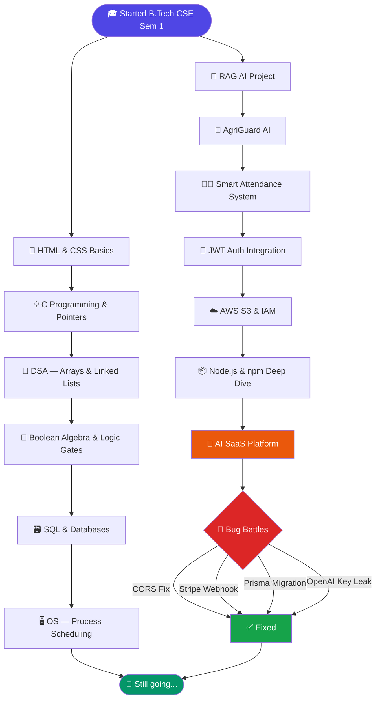
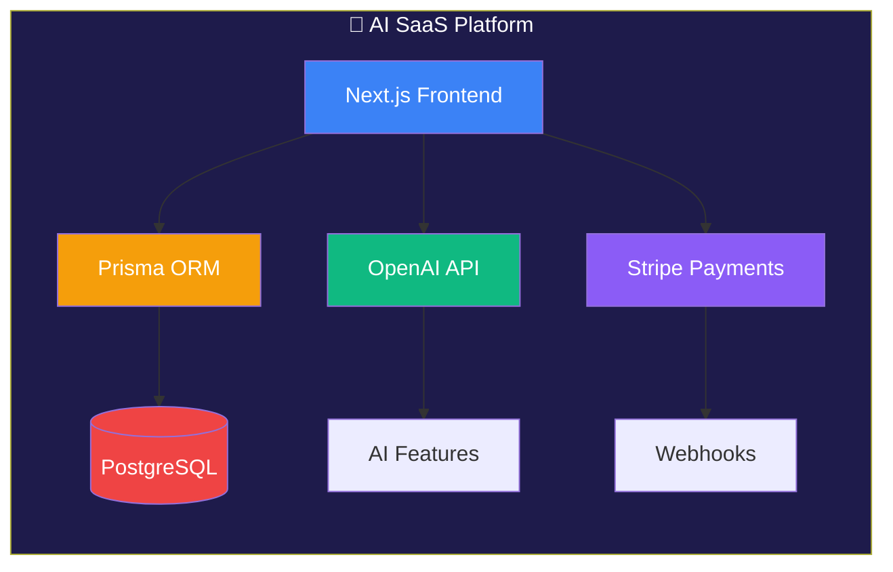
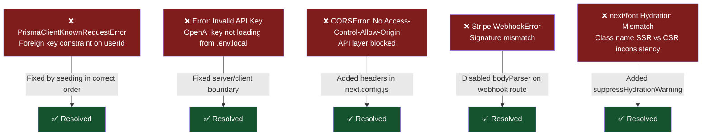
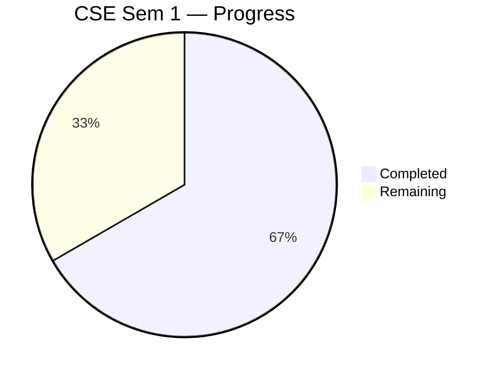
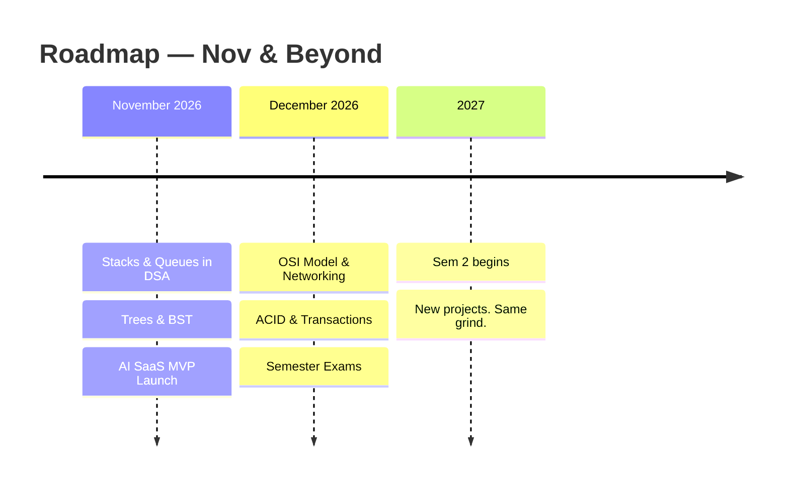

 

 

---

## 👨‍💻 About This Journal

> *A living record of my journey through code, crashes, concepts, and curiosity.*

This repository is my personal developer diary — documenting every meaningful thing I build, break, debug, and learn. From academic fundamentals in **B.Tech CSE (Sem 1)** to real-world AI application development, this log captures the full picture of growth as an engineer.

> *"Every expert was once a beginner who refused to give up."*

---

## 🗺️ The Learning Journey — Flowchart

---

## 🚀 Current Focus

**Stack:** `Next.js` · `TypeScript` · `Prisma` · `Stripe` · `OpenAI API` · `Tailwind CSS`
**Phase:** 🔥 Active Development — Debugging & Feature Integration

---

## 📅 Development Timeline

### 🌱 September 2026

| Date | Tag | What I Did |
|------|-----|------------|
| **Sept 01** | 🚀 Init | Successfully initialized the repository and structured the professional daily log layout. First commit — the journey begins. |
| **Sept 02** | 🤖 AI | Kicked off a **RAG (Retrieval-Augmented Generation)** AI project. Set up the frontend scaffolding with `package.json` and planned the vector DB pipeline. |
| **Sept 05** | 📐 DSA | Studied **Arrays & Time Complexity** (Big O notation) — core CSE Sem 1 concept. Solved 5 problems on linear search and frequency counting. |
| **Sept 07** | ⚡ Academics | Completed and finalized the comprehensive **Electronics Lab Manual** — every circuit documented, every reading recorded. |
| **Sept 10** | 🌐 Web Basics | Learned the fundamentals of **HTML5 semantics and CSS box model**. Built a static portfolio page from scratch as a practice exercise. |
| **Sept 14** | 💡 C Programming | Understood **pointers and memory addresses** in C — the concept that confuses every CSE fresher. Finally clicked! Drew memory diagrams to solidify understanding. |
| **Sept 18** | 🔢 Maths | Covered **Boolean Algebra and Logic Gates** (AND, OR, NOT, NAND, NOR, XOR) for Digital Electronics. Built truth tables for half adder and full adder. |
| **Sept 20** | 🎉 Milestone | Celebrated another year of life and learning! 🎂 Grateful for the grind. |
| **Sept 22** | 🌾 AI | Launched **AgriGuard AI** — an intelligence-driven project targeting smart agricultural monitoring and crop health prediction. |
| **Sept 25** | 🖥️ OS Concepts | Studied **Process Scheduling algorithms** — FCFS, SJF, Round Robin. Simulated examples on paper to understand context switching. |
| **Sept 29** | 📚 Exam Prep | Dedicated the day to final revisions for the **Electronics & Communication Exam**. Covered modulation techniques and op-amp circuits. |

---

### 🍂 October 2026

| Date | Tag | What I Did |
|------|-----|------------|
| **Oct 02** | 🗃️ Databases | Started learning **SQL basics** — CREATE, INSERT, SELECT, WHERE, JOIN. Created a mini student database as a practice project. Normalization (1NF, 2NF, 3NF) next. |
| **Oct 07** | 🧑‍🏫 Project | Started building **Smart Attendance System** — architecting the face recognition pipeline and backend API structure. |
| **Oct 10** | 🔐 Auth | Integrated **JWT-based authentication** into Smart Attendance System. Understanding the difference between session tokens and JWTs was a valuable lesson. |
| **Oct 15** | ☁️ Cloud | Got hands-on with **AWS S3 basics** — uploaded, retrieved, and deleted objects via the console. Set up bucket policies and understood IAM roles at a surface level. |
| **Oct 18** | 📦 npm & Node | Deep-dived into **Node.js module system** (CommonJS vs ES Modules). Resolved a tricky circular dependency bug that took 2 hours to trace. Learned to use `--inspect` flag for Node debugging. |
| **Oct 20** | 🧩 DSA | Studied **Linked Lists** — singly and doubly linked. Implemented insert, delete, and reverse operations in C. Visualized with pointer diagrams. |
| **Oct 22** | 🐛 Debugging | Battled multiple errors in the **AI SaaS project**. Traced a `CORS policy` issue across the API layer and fixed an environment variable leak in the Next.js config. Progress is progress, even when it's all red. |
| **Oct 23** | 🤖 AI SaaS | Working on the **AI SaaS platform** — integrating OpenAI API endpoints, hitting rate limit errors, debugging Prisma schema migration conflicts, and fixing a broken Stripe webhook handler. Error by error, the product is taking shape. |
| **Oct 25** | 📝 Academics | Dedicated the day to completing **college assignments** — organized, documented, and tracked all pending work directly on **GitHub**. Practiced using Git for academic task management: structured commits, clear descriptions, and version-controlled submissions. Productivity level: maximum. |
| **Oct 26** | 🔢 Maths | Completed the **Mathematics assignment** — wrapped up all problems, verified solutions, and submitted on time. Consistency with academics while keeping the dev grind alive. ✅ |
| **Oct 27** | 📋 Academics | Triple win today — completed the **Electronics assignment**, the **Communication assignment**, and the **Programming Language assignment** all in one sitting. On top of that, finalized and polished the **presentation for SIH (Smart India Hackathon)**. Academic grind + project hustle, same day. 🔥 |
| **Oct 29** | 🧠 Reflection | Took a step back and looked at everything built so far — from a static HTML page in September to a full-stack **AI SaaS platform** with OpenAI, Stripe, and Prisma in October. That's not a beginner arc, that's a **speedrun**. Still in Sem 1, still fighting assignment deadlines, still debugging at midnight — and somehow shipping real products. Most people wait until they "know enough" to start. The realization today: you never know enough, you just build anyway. The bugs, the CORS errors, the broken webhooks — all of it is just the price of building things that actually exist. |

---

## 🐛 Errors I Fought — Debug Log

> *The best developers aren't the ones who write perfect code — they're the ones who debug fearlessly.*

---

## 🛠️ Tech Stack & Tools

---

## 📚 B.Tech CSE Sem 1 — Concepts Log

| Concept | Status | Area |
|---------|--------|------|
| Number Systems (Binary, Octal, Hex) | ✅ Done | Digital Electronics |
| Boolean Algebra & Logic Gates | ✅ Done | Digital Electronics |
| C Programming — Variables, Loops, Functions | ✅ Done | Programming |
| C Programming — Pointers & Memory | ✅ Done | Programming |
| Arrays & Time Complexity (Big O) | ✅ Done | DSA |
| Linked Lists (Singly & Doubly) | ✅ Done | DSA |
| Process Scheduling (FCFS, SJF, Round Robin) | ✅ Done | OS |
| SQL Basics (DDL, DML, Joins) | ✅ Done | DBMS |
| Stacks & Queues | ⏳ Next | DSA |
| Trees & Binary Search Trees | ⏳ Soon | DSA |
| Computer Networks — OSI Model | ⏳ Soon | Networks |
| DBMS — Transactions & ACID Properties | ⏳ Soon | DBMS |

**Progress: `████████░░░░` 67%**

---

## 📈 Stats

| 📆 Days Logged | 🐛 Bugs Squashed | 💡 Concepts Learned | 🚀 Projects Shipped | ☕ Coffee |
|:-:|:-:|:-:|:-:|:-:|
| **22+** | **Lost count** | **Growing daily** | **3+** | **Immeasurable** |

---

## 🧭 What's Next

---

*"It's not about having time. It's about making time."*

**Built with curiosity, caffeine, and compiler errors ☕🔥**

